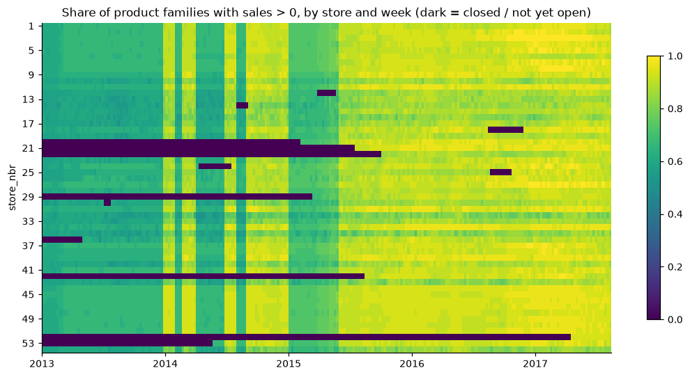
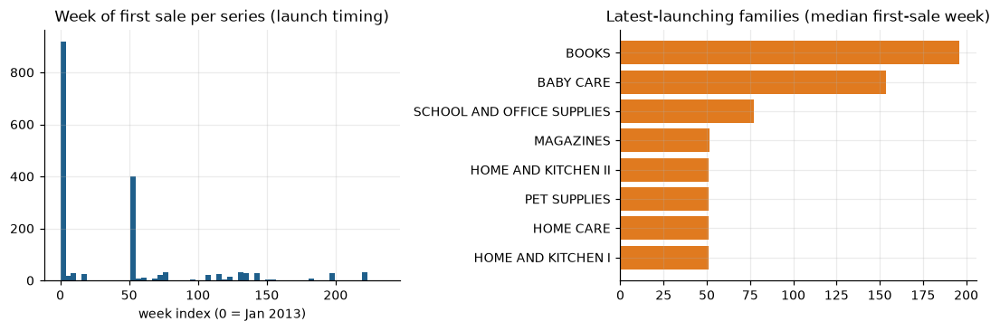
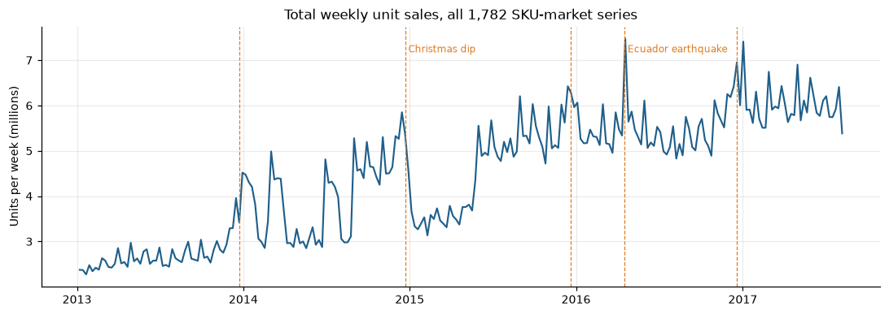
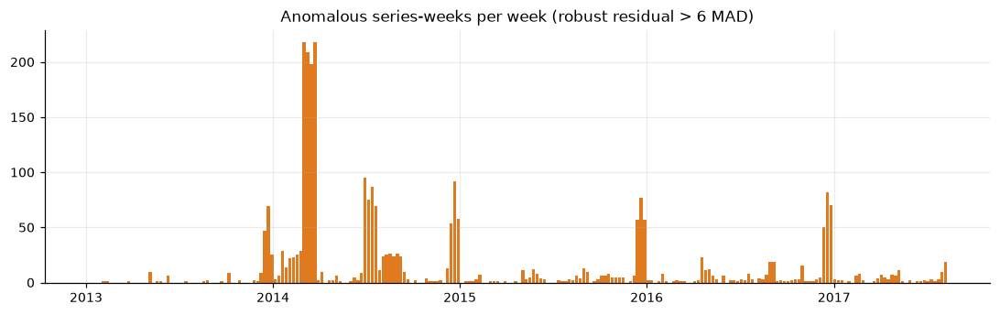
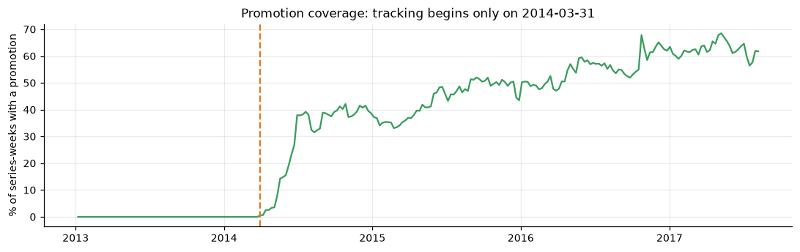
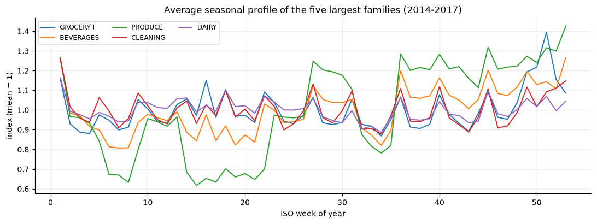
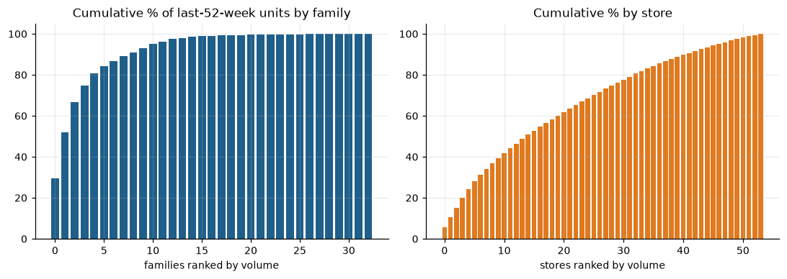
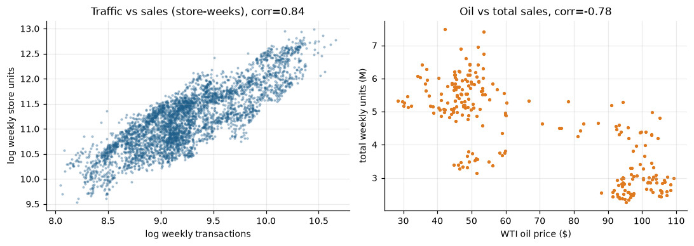
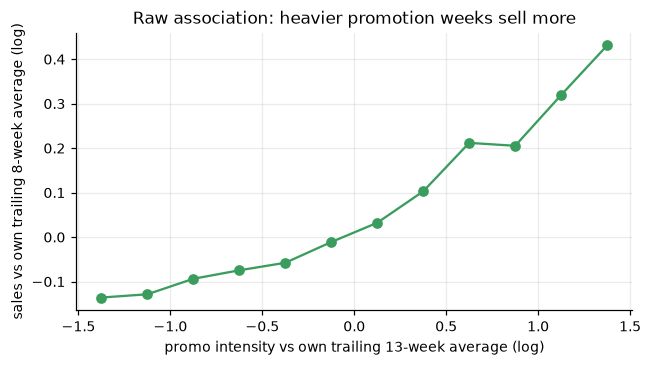
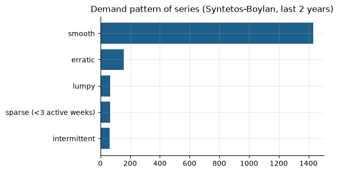

# 01 - Data-quality & EDA report

*Dataset:* 3,000,888 daily rows, 2013-01-01 to 2017-08-15, 54 stores x 33 product families = **1,782 SKU-market series** (market = store, SKU = product family; see README "Dataset mapping").

## 1. Structural checks

| Check | Result |
|---|---|
| Duplicate (date, store, family) keys - train / test | 0 / 0 |
| Duplicate (date, store) keys in transactions | 0 |
| Null cells in train | 0 |
| Negative sales rows | 0 |
| Rows missing within observed days (should be 0) | 0 |
| Calendar days absent from the data | 4 - 2013-12-25, 2014-12-25, 2015-12-25, 2016-12-25 (every 25 December: stores closed) |
| Share of rows with fractional units | 15.4% (weight-sold families such as PRODUCE, MEATS, POULTRY...) |
| Share of rows with zero sales | 31.3% |
| Oil prices missing | 43 of 1218 days (weekends/holidays) -> forward/back-filled |
| Store-days with sales but no transactions record | 118 |
| Holiday calendar ends | 2017-12-26 (covers the whole 13-week horizon) |

**Treatment.** The 25-Dec gap is kept (weeks have 6 days; a calendar feature ``ndays`` and ``xmas`` flag let the model learn the closure).
The first partial week (Jan 2013) and the last partial week (14-15 Aug 2017) are dropped from the history. Transferred holidays are
re-dated using the *Transfer* rows. Oil is only ever used as a lagged, origin-dated feature, so no future oil assumption is needed.

## 2. Weekly panel & missing weeks

History = **240 complete weeks** (2013-01-07 to 2017-08-07 week-starts). Weeks with fewer than 7 days: 2013-12-23, 2014-12-22, 2015-12-21, 2016-12-19.
No full week is missing for any store-family row (the table is a complete panel); gaps are instead *business* gaps - closures, launches, delistings.

## 3. Launches, delistings and closures (affects forecastability)

* **53 series never sold** in the whole history (forecast = 0 by rule).
* **786 series launched after the first two months** (new store or new family; e.g. BOOKS, BABY CARE, store 52). Pre-launch zeros are treated as *missing*, not demand.
* **43 series show >= 8 trailing zero weeks** -> treated as delisted (forecast 0).
* **Reporting gaps:** 1,031 spells (in 554 series) of 8+ consecutive zero weeks inside a series' life after which sales *resume*
  = 17,342 series-weeks (5.0% of active data). By start year: {2013: 188, 2014: 7599, 2015: 7284, 2016: 2075, 2017: 196}.
  Whole families vanish together (e.g. PRODUCE, HOME CARE, CELEBRATION in 2014-15), so these are data-recording gaps, not zero demand.
  **Treatment:** such weeks are removed from *training targets* (only for gaps already over at the fold origin, so no look-ahead) and from the scored universe
  (they are 2.0% of the CV windows); a sensitivity table reports accuracy with them included. Features still see the raw zeros, exactly as production would.
* **8 stores opened after Jan 2013** and 54 store-weeks are whole-week closures
  (all families zero while the store is otherwise open): these weeks are masked from training and excluded from scoring because closures are unpredictable.

Median first-sale week by family and store openings are in `outputs/tables/dq_family_launch_week_median.csv`, `dq_store_openings.csv`, `dq_store_closures.csv`.

## 4. Unusual sales movements

A robust detector (residual to a 9-week centred median, > 6 x MAD, > 0.8 log-points, > 20 units) flags **2,808 series-weeks (0.81% of active data)**.
Largest clusters: 2014-03-03 (218), 2014-03-24 (218), 2014-03-10 (209), 2014-03-17 (198), 2014-06-30 (95), 2014-12-22 (92).
The Feb-Mar 2014 clusters are the *return* of families after a reporting gap (levels jump back, flagged as spikes), the Dec-2014 cluster is the
Christmas/new-year effect, and April 2016 shows the earthquake. Genuine demand shocks (holidays, earthquake) are explainable by calendar features
and are **kept** in the targets (no winsorising); closures and reporting gaps are masked as described above.

## 5. Promotions and other drivers

* Promotion tracking **starts 2014-03-31**; earlier values are all zero and are encoded as *missing* (not "no promo"). Afterwards 47% of series-weeks carry some promotion.
* Raw association: heavier promo weeks sell more (slope 0.20 log-points per log-point of promo intensity).
* Store traffic is strongly tied to sales (corr of logs 0.84) but is *not known in the future* -> lag-only.
* Oil price vs total weekly sales correlation -0.78 (a trend artefact as much as a driver) -> lag-only, tested in the ablation.
* Concentration: top families GROCERY I 30%, BEVERAGES 22%, PRODUCE 15%, CLEANING 8%, DAIRY 6%; 9 of 33 families make 90% of volume.

## 6. Demand patterns (sparse / cold-start awareness)

| class                    |   n_series |
|:-------------------------|-----------:|
| smooth                   |       1433 |
| erratic                  |        159 |
| lumpy                    |         65 |
| sparse (<3 active weeks) |         64 |
| intermittent             |         61 |

Intermittent and sparse series are a minority by volume, which motivates (a) a log-scale model, (b) a peer-group cold-start fallback and (c) volume-weighted training.

## 7. Test file

`test.csv` covers 2017-08-16 to 2017-08-31 for 1,782 series (0 not in train). It has **no sales**
(a held-out Kaggle-style file), so it cannot score the models; it provides the *promotion plan* for the first ~2.6 forecast weeks. Beyond that the
promotion plan is assumed (carry-forward of the last 28 days).
