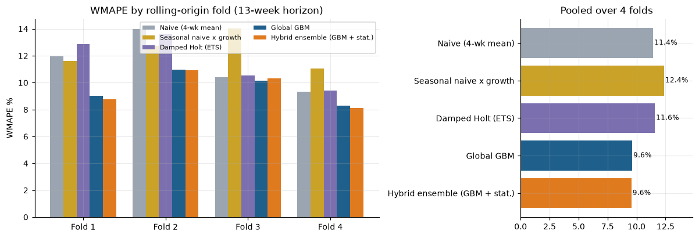
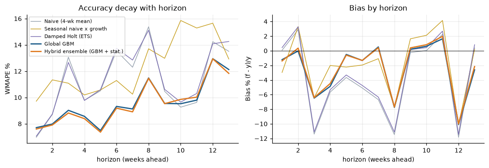
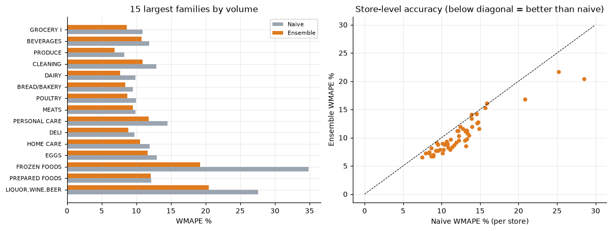
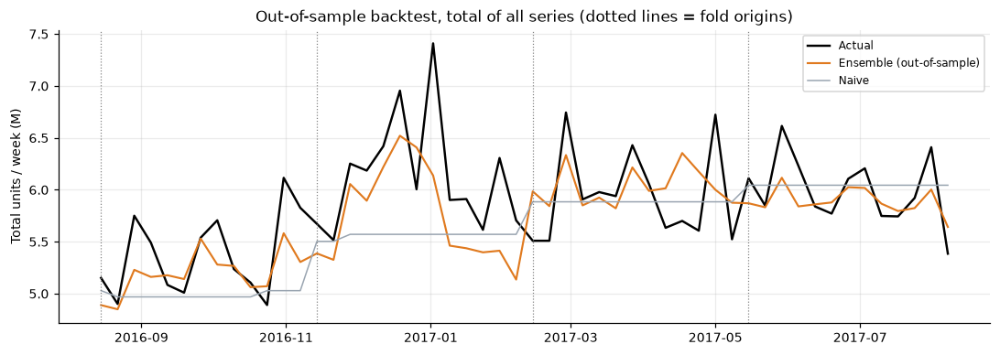
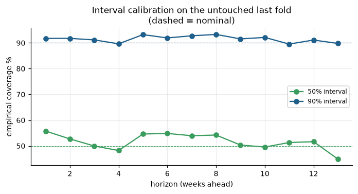
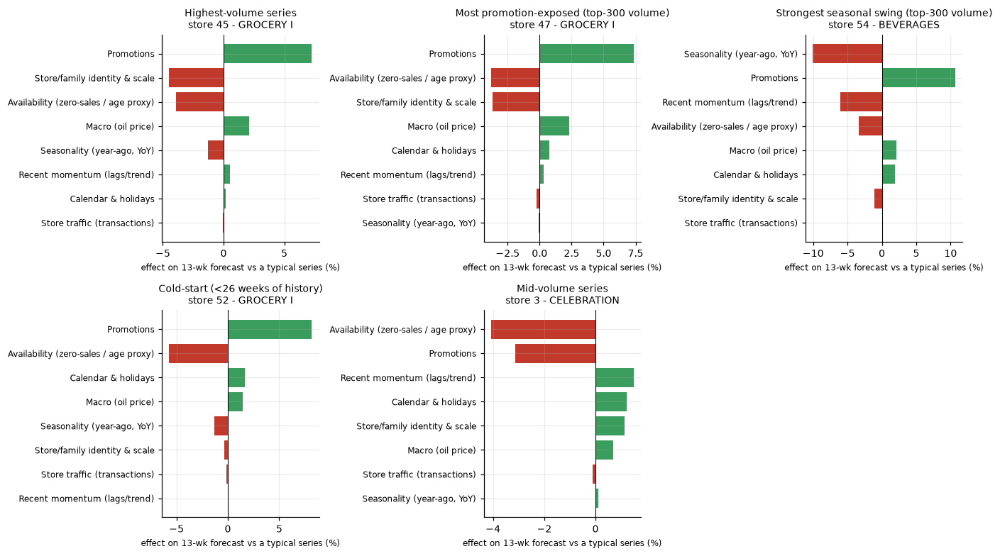
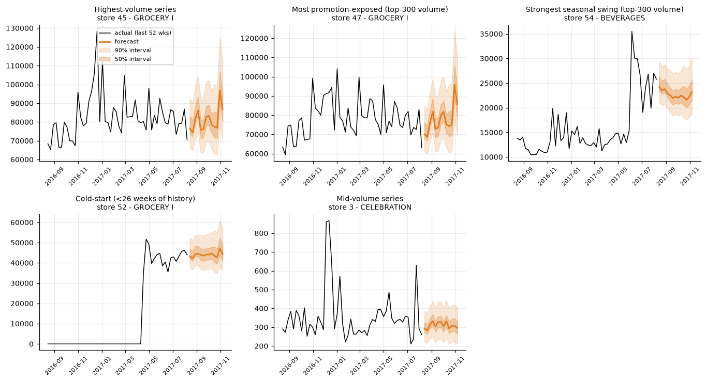
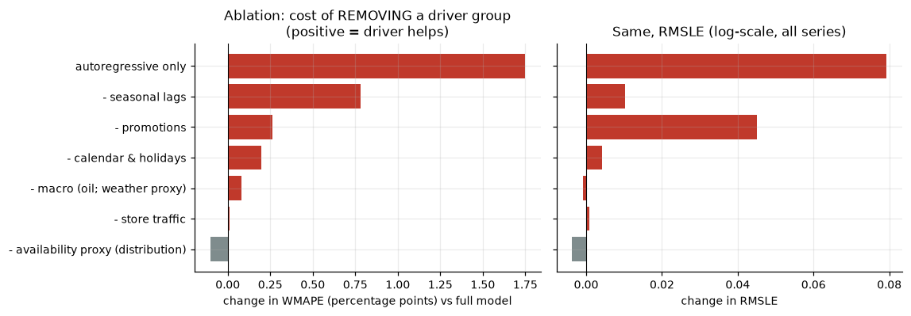
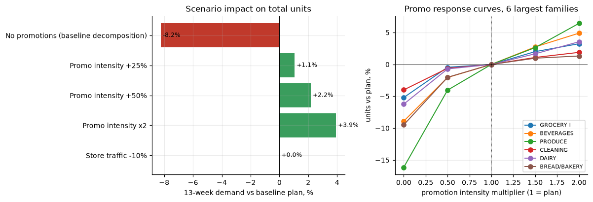

# FreshBasket FMCG Demand Forecasting - Project Report

**Task:** weekly unit forecasts for the next 13 weeks for every SKU-market combination, with uncertainty, driver explanation, ablation and scenarios.
**Forecast window:** weeks starting 2017-08-14 to 2017-11-06 (ending 2017-11-12). **Series:** 1,782 (54 stores x 33 product families).

---

## 1. Executive summary

* **Result.** A single global gradient-boosting model, blended 90/10 with a seasonal-naive forecast, cuts out-of-sample **WMAPE from 11.4% (naive 4-week mean) to 9.6%** and **RMSLE from 0.51 to 0.40**, pooled over four rolling-origin folds (85,695 series-weeks). Totals are forecast within **5.2% WMAPE** (naive 6.8%). 32 of 33 families and 53 of 54 stores beat the naive baseline.
* **Uncertainty.** Conformal intervals calibrated on folds 1-3 cover **91.4%** (nominal 90%) and **51.8%** (nominal 50%) of outcomes on the untouched fold 4.
* **Drivers.** Year-ago seasonality is the most valuable input (+9.2% relative WMAPE if removed), then promotions (+3.1%) and calendar/holidays (+2.3%). Store traffic adds nothing beyond sales history. Promotions rank first in the permutation test on RMSLE.
* **Scenarios.** Removing all promotions lowers 13-week demand about 7.3%; +25% / +50% / x2 promo intensity lifts it +1.1% / +2.2% / +4.0%. These are model-implied associations, not causal estimates, and extreme cases can be implausible.
* **Headline forecast:** about **77.8 million units** over the 13 weeks, peaking in the week of 30 October.
* **Important caveat.** The supplied files are the *Store Sales* retail dataset, not the FMCG schema in the brief. Price, weather, media and true distribution data do not exist in it, so those drivers could not be modelled or ablated; proxies are used and are labelled as such throughout.

## 2. Problem understanding and data mapping

Management needs a robust weekly forecast reflecting promotions, pricing, distribution, seasonality, holidays and market differences, to plan inventory and trade activity. The supplied data (`train, test, stores, transactions, oil, holidays_events`) were mapped to the brief as follows:

| Brief concept | Used here | Limitation |
|---|---|---|
| market_id | `store_nbr` (54 stores) | |
| sku_id | product `family` (33) | families, not individual SKUs |
| units | `sales` aggregated to Monday-start weeks | some families are sold by weight (fractional units) |
| promotion | `onpromotion` (number of items of the family on promotion) | no discount depth or promo type |
| price | **not available** | price elasticity cannot be estimated |
| distribution | availability proxy: share of zero-sales days, series age, zero streak | proxy only |
| weather | **not available**; oil price used as the only external macro driver | proxy only |
| media | **not available** | |
| calendar | national / regional / local holidays, transfers, events, paydays, Christmas / New Year, 25-Dec closure | |
| (extra) | store `transactions` (traffic), lag-only | not known in the future |

## 3. Data quality and EDA (full detail: `outputs/reports/01_data_quality_and_eda_report.md`)

| Finding | Evidence | Treatment |
|---|---|---|
| Panel is structurally complete | 3,000,888 rows; 0 duplicate keys; 0 nulls; 0 negative sales; 0 missing store-family rows on observed days | none needed |
| 25 December absent every year | 4 missing calendar days | kept; `ndays`/`xmas` features |
| **Reporting gaps** | 1,031 spells of 8+ zero weeks followed by resumed sales, in 554 series = 17,342 series-weeks (**5.0%** of active data; 2014: 7,599, 2015: 7,284). Whole families (PRODUCE, HOME CARE, CELEBRATION...) vanish together | removed from *training targets* only for gaps already over at each fold origin (leakage-safe); excluded from scoring (about 2% of CV series-weeks); sensitivity reported |
| Launches | 786 series first sell after week 8 (8 stores opened after Jan 2013, incl. store 52 in Apr 2017; BOOKS, BABY CARE launched later) | pre-launch zeros are *missing*, not demand; cold-start fallback |
| Never sold / delisted | 53 series never sold; 43 have 8+ trailing zero weeks | forecast 0 by rule (seasonal exception, see section 6) |
| Store closures | 54 whole-week closures | masked from training, excluded from scoring |
| Promotion tracking | starts 2014-03-31; zero before; 47% of series-weeks promoted afterwards | earlier values encoded as missing |
| Anomalies | 2,808 series-weeks (0.8%) flagged by a robust residual detector; clusters in Feb-Mar 2014 (families returning after gaps), Christmas 2014, April 2016 earthquake | genuine, calendar-explainable shocks are kept (no winsorising) |
| Traffic and oil | 118 store-days with sales but no transactions; 43 of 1,218 oil prices missing | traffic gaps left as missing; oil forward/back-filled |
| Demand patterns | 1,433 smooth, 159 erratic, 65 lumpy, 64 sparse series | log-scale target, volume weighting, cold-start fallback |
| Concentration | GROCERY I 30%, BEVERAGES 22%, PRODUCE 15% of volume; 9 of 33 families make 90% | volume-weighted training |

Raw association: promotion weeks sell more (slope about 0.20 log-points per log-point of promo intensity). The store-traffic / sales correlation is 0.84 (logs) but traffic is unknown in the future, so it is lag-only.

## 4. Modelling dataset and features

The panel holds **240 complete weeks** (2013-01-07 to 2017-08-07 week-starts) for 1,782 series; the first partial week and the final partial week (14-15 Aug) are dropped. For forecast origin *t* (last observed week) and horizon *h* = 1..13 the model predicts

> log1p(units[t+h]) - run-rate[t],   run-rate[t] = mean of log1p(units) over weeks t-7..t

so the trees learn *drivers of deviation* rather than 1,782 volume scales. Features (59, in nine groups, `src/features.py`):

| Group | Examples |
|---|---|
| Recent momentum (AR) | 8 lags relative to run-rate, 4/13/26-week means, volatility, trend |
| Seasonality | value one year before the target week (raw and 3-week smoothed), 2-year lag, YoY growth |
| Promotions | planned promo items in the target week, relative to the trailing 13-week level, year-ago promo, last-4-week level |
| Availability proxy | zero-sales share (1 and 4 weeks), zero streak, series age, active share |
| Store traffic | transactions: latest vs 13-week level, 4-week vs 13-week, YoY, level (lag-only) |
| Macro | oil level, 13-week change, YoY (origin-dated, lag-only) |
| Calendar | week of year, month, national/regional/local holiday counts, bridge / work-day, events (Mother's Day, Black Friday, Cyber Monday, earthquake), paydays, Christmas, New Year, days in week |
| Attributes | store, family, store type, cluster, city, state, run-rate, 52-week volume |
| Horizon | *h* |

**Leakage controls.** Historical arrays are read only at columns <= *t*; seasonal lags read column *j*-52 <= *t*-39; the only look-ahead inputs are known-in-advance covariates of the target week (calendar, promotion plan). `tests/test_pipeline.py` scrambles *all* data after *t* and asserts the features are unchanged, and asserts that no training target lies beyond a fold's origin.

**Future exogenous variables.**

| Variable | Future value |
|---|---|
| Calendar / holidays | known (holiday file runs to Dec 2017) |
| Promotion plan | weeks 1-2 fully and week 3 for 4 of 7 days come from `test.csv`; after that **assumed** = mean of the last 28 known days |
| Store traffic, oil | never needed: lagged, origin-dated features only |

## 5. Validation design

Expanding-window **rolling-origin cross-validation**, 4 folds x 13 weeks, tiling the last 52 observed weeks (origins 2016-08-08, 2016-11-07, 2017-02-06, 2017-05-08). Every season, including Christmas and Carnival, is scored once out-of-sample. The model for fold *k* is trained only on rows whose **target week is on or before its origin** (purged); no random splits are used anywhere. Training rows use every third origin, are randomly sub-sampled to about 340k rows (training only), and are recency- and volume-weighted. Scoring excludes series not yet launched, whole-week closures and reporting-gap weeks; a sensitivity including the latter is in section 7.4.

Metrics are computed on raw units: **WMAPE**, **RMSE**, signed **bias** ((sum forecast - sum actual) / sum actual) and **RMSLE**.

## 6. Models compared

1. **Naive** - mean of the last 4 weeks.
2. **Seasonal naive x growth** - smoothed value one year earlier times the trailing-13-week year-on-year growth (clipped 0.6-1.6).
3. **Damped-trend Holt** (exponential smoothing on log units, fixed conventional parameters, per series).
4. **Global gradient boosting** - scikit-learn `HistGradientBoostingRegressor`, one model for all series and horizons (direct strategy), native handling of missing values.
5. **Hybrid ensemble** - 0.9 x GBM + 0.1 x seasonal naive; partner and weight chosen on folds 1-3 only (grid over three partners and 11 weights), so fold 4 stays an untouched check.

### Cold start, sparse series and business rules

* Series with fewer than 13 weeks of history use the best fallback on the CV data: **damped Holt** (6.6% WMAPE, bias +0.1%) versus the GBM (15.7%, bias -14.3%), peer-group (12.9%) and a GBM/peer blend (9.8%). This is based on only 881 series-weeks and was selected on the same data, so it is optimistic.
* Never-sold or not-yet-launched series forecast 0. **Delisted** series (8+ trailing zero weeks) forecast 0 *unless the series sold around the same calendar week a year earlier*. A first version without that exception zeroed 955 forecasts, 311 of which later had sales (mostly SCHOOL AND OFFICE SUPPLIES and HOME APPLIANCES, which are seasonally zero) and raised RMSLE from 0.395 to 0.417; the seasonal exception brought it to 0.398.
* Forecasts are non-negative and capped at 3x the series' 52-week maximum.

## 7. Results

### 7.1 Model comparison (pooled, 4 folds, 85,695 series-weeks)

| Model | WMAPE | RMSE | Bias | RMSLE |
|---|---|---|---|---|
| Naive (4-wk mean) | 11.43% | 1,523 | -4.2% | 0.513 |
| Seasonal naive x growth | 12.38% | 1,699 | -2.0% | 0.524 |
| Damped Holt | 11.58% | 1,520 | -3.8% | 0.520 |
| Global GBM | 9.73% | 1,281 | -2.9% | 0.398 |
| **Hybrid ensemble** | **9.64%** | **1,275** | **-2.8%** | **0.398** |

By fold (WMAPE %):

| Fold (test window) | Naive | Seas. naive | Holt | GBM | Ensemble |
|---|---|---|---|---|---|
| 1 (Aug-Nov 2016) | 11.97 | 11.62 | 12.86 | 9.41 | 9.12 |
| 2 (Nov 2016-Feb 2017) | 14.01 | 12.73 | 13.59 | 11.18 | 11.09 |
| 3 (Feb-May 2017) | 10.40 | 14.04 | 10.55 | 9.88 | 10.08 |
| 4 (May-Aug 2017) | 9.34 | 11.05 | 9.41 | 8.39 | 8.18 |

Honest reading: the GBM is the main gain. The ensemble improves slightly on three folds but is slightly *worse* than the GBM on fold 3 (10.08% vs 9.88%), and the margin over naive on fold 3 is thin (10.1% vs 10.4%).

### 7.2 By horizon, segment and aggregation level

* **Horizon.** Ensemble WMAPE rises from 7.0% (week 1, equal to naive) to 11.9% / 13.8% (weeks 12 / 13). It beats naive at most horizons but is slightly worse at weeks 10 and 11 (10.1% vs 9.3%, 10.0% vs 9.6%).
* **Families and stores.** 32 of 33 families and 53 of 54 stores beat naive; median per-series WMAPE 18.1% vs 20.6%. Store types A-E improve 11-17% relative (e.g. type A 10.7% to 9.0%).
* **Volume tiers (ensemble vs naive WMAPE):** smallest quartile 48.9% vs 49.6%, Q2 24.8% vs 29.4%, Q3 12.7% vs 16.3%, largest 9.2% vs 10.8%. **Small series are essentially not improved.**
* **Bottom-up aggregates (ensemble vs naive):** total weekly units 5.2% vs 6.8%; family-week 6.3% vs 8.0%; store-week 7.4% vs 9.1%. Forecasts are coherent because totals are sums of the series forecasts.

### 7.3 Is the promotion plan needed?

With the promotion plan *unknown* (last-4-week average carried forward) in the target weeks, GBM WMAPE barely moves (9.73% to 9.77%) but **RMSLE worsens from 0.398 to 0.449**: volume-heavy series are robust, but promoted and small series are not. The real trade calendar should be supplied beyond week 3 (the final forecast assumes it from week 4).

### 7.4 Sensitivities

| Variant | WMAPE | RMSLE |
|---|---|---|
| GBM, with business rules (final) | 9.73% | 0.398 |
| GBM, without business rules | 9.73% | 0.395 |
| Ensemble, primary scoring universe | 9.65% | 0.398 |
| Ensemble, **including** reporting-gap weeks | 9.65% | 0.408 |
| Naive, including reporting-gap weeks | 11.44% | 0.519 |

The rule layer is neutral on WMAPE and marginally worse on RMSLE (0.003) in exchange for sensible zero forecasts for delisted series; including gap weeks leaves the ranking of models unchanged.

## 8. Prediction intervals

Mondrian split-conformal intervals on log-residuals, calibrated per horizon bin (1-4, 5-9, 10-13) x series-volume quartile from **out-of-sample** residuals. Calibrated on folds 1-3, evaluated on fold 4:

| Interval | Nominal | Empirical coverage | Mean width (units) |
|---|---|---|---|
| 50% | 50% | **51.8%** | 522 |
| 90% | 90% | **91.4%** | 1,524 |

Coverage by horizon stays within 89-93% for the 90% band; the 50% band under-covers at week 13 (43%). Coverage is mildly conservative for the largest-volume tier (93% / 56%). The final intervals use all four folds. They are marginal (not conditional) guarantees and assume future residuals resemble past ones.

## 9. Explainability

**Global (permutation importance on folds 2 and 4, change in RMSLE / WMAPE points):** promotions 0.101 / +1.0; recent momentum 0.081 / +5.4; store/family identity and scale 0.057 / +5.0; seasonality 0.040 / +5.1; availability proxy 0.035 / +6.1; calendar 0.009 / +0.6; store traffic about 0. Oil is shown as n/a: it is identical for every row of a single forecast origin, so shuffling rows cannot test it - the ablation is the evidence for oil. Permutation can overstate correlated features (the availability proxy ranks high here but removing it helps WMAPE in the ablation).

**Local (exact Shapley values over 8 driver groups; attributions sum exactly to the model output, verified to 1e-16).** Five series were selected automatically (not hand-picked): highest volume, most promotion-exposed, strongest seasonal swing, a cold-start series, a mid-volume series. Effects are relative to a typical series. The forecast reads as *run-rate x exp(base + driver effects)*:

* Store 45 GROCERY I (highest volume) and store 47 GROCERY I: promotions add about +5%, calendar about +0.5-1%, the series' scale/identity about -4%.
* Store 54 BEVERAGES (strongest seasonal swing): promotions +8%, year-ago seasonality about -11%.
* Store 52 GROCERY I (opened April 2017, 16 weeks of history): promotions +5%, availability proxy (short history) -3.5%.
* Store 3 CELEBRATION (mid-volume): promotions -3.4%, calendar +1.8%.

## 10. Ablation / feature-impact study

Each variant removes one driver group, retrains from scratch (lighter configuration: about 170k rows, 70 trees, so levels differ slightly from section 7) and is re-scored on all four folds.

| Variant | WMAPE | change (pp) | relative | RMSLE | folds where worse |
|---|---|---|---|---|---|
| Full model | 10.00% | - | - | 0.402 | - |
| - promotions | 10.31% | +0.31 | +3.1% | 0.442 | 3 / 4 |
| - calendar & holidays | 10.23% | +0.23 | +2.3% | 0.404 | 3 / 4 |
| - seasonal lags | 10.92% | +0.92 | +9.2% | 0.410 | 4 / 4 |
| - availability proxy (distribution) | 9.81% | -0.18 | -1.8% | 0.406 | 0 / 4 |
| - store traffic | 10.01% | +0.01 | +0.1% | 0.403 | 2 / 4 |
| - macro (oil; weather proxy) | 10.16% | +0.17 | +1.7% | 0.401 | 2 / 4 |
| Autoregressive only | 11.69% | +1.70 | +17.0% | 0.483 | 4 / 4 |
| *Price* | not testable - no price data | | | | |

Conclusions: seasonal lags, promotions and calendar clearly help; the exogenous inputs together are worth about 17% relative WMAPE. Store traffic adds nothing once sales history is known. Oil helps WMAPE slightly but not RMSLE - treat as weak evidence. The availability proxy is **mixed**: removing it improves WMAPE in all four folds but worsens RMSLE (small series), so it was kept. Per-fold differences can be small relative to noise; consistency across folds is shown in the last column.

## 11. Scenario and sensitivity analysis

The trained model is re-run with modified known inputs; the baseline is the planned promotion calendar. Promotion increases are capped at 1.5x each series' own 52-week maximum to avoid extrapolation.

| Scenario | 13-week units vs baseline | Series up / down |
|---|---|---|
| No promotions (baseline vs promotion decomposition) | **-7.3%** (-5.6M units) | 2% / 68% |
| Promo intensity +25% | +1.1% (+0.87M) | 66% / 2% |
| Promo intensity +50% | +2.2% (+1.73M) | 68% / 1% |
| Promo intensity x2 | +4.0% (+3.12M) | 69% / 1% |
| Store traffic -10% | -0.06% | 20% / 42% |

The response is roughly linear and mildly diminishing. By family, PRODUCE (-16% without promotions), BEVERAGES (-6.6%) and GROCERY I (-4.6%) respond most among the large lines; seasonal lines respond most in percentage terms at +50%.

**How to read these.** Promotions in the history were not randomised, so these are associations, not causal lifts. Extreme cases can be unreliable: with no promotions the model predicts SCHOOL AND OFFICE SUPPLIES falls 96%, which is not credible, and the PRODUCE figure may partly reflect promo counts having grown together with sales. The -10% traffic scenario barely moves the forecast because the model hardly uses traffic (consistent with the ablation) - it is a sensitivity check, not a business insight. Use the promo numbers for direction and ranking, and validate with a controlled test before committing budget.

## 12. Limitations

1. **Data.** No price, weather, media or true distribution data; proxies only. Families, not individual SKUs. The price and distribution sections of the brief therefore cannot be answered directly.
2. **Small-volume series** (bottom volume quartile) are barely improved (WMAPE about 49%); the model's value is concentrated in mid- and large-volume lines and in aggregates.
3. **Promotion plan** beyond week 3 is assumed; if the real plan differs, log-scale accuracy (RMSLE 0.40 to 0.45) and promoted series suffer.
4. **Tuning on the evaluation folds.** The volume-weight exponent (0, 0.3, 0.6 compared), the cold-start choice and the delisting-rule fix were chosen using the same folds; the reported results are slightly optimistic. The ensemble weight was chosen on folds 1-3 only.
5. **Thin margins.** Fold 3 shows little gain over naive (10.1% vs 10.4%); the ensemble gain over the GBM alone (9.73% to 9.64%) is within noise.
6. **Negative bias.** Forecasts are 2.8% low on average (log-scale training); a bias correction could be added.
7. **Scoring universe.** Closures and reporting gaps (about 2-3% of series-weeks) are excluded from the primary score using hindsight; results including them are in section 7.4.
8. **Scenario effects** are associations and extreme multipliers can be implausible. **Permutation importance** can mislead for correlated or origin-constant features.
9. **Reproducibility.** Seeds are fixed, but exact numbers can differ slightly across scikit-learn versions and platforms. `test.csv` has no sales, so the final forecast could not be scored.
10. The CV windows are the last 52 weeks only; older regimes (2014-15 gaps) are not part of the scoring.

## 13. Recommendations for business use

1. Use the forecasts for **aggregate and large/mid-volume planning** (inventory, trade budgets); treat small-volume lines with caution or pool them.
2. Use the **90% band as an input to safety stock**, and monitor realised coverage monthly.
3. **Provide the real promotion calendar** for the full horizon; it matters most for promoted and small series.
4. **Retrain monthly**; track WMAPE, bias and coverage by horizon, family and store; investigate any store or family that drifts.
5. **Fix data at source:** flag reporting gaps, launches, closures and delistings so zeros are not read as demand; capture price, discount depth, distribution and weather.
6. Run **controlled promotion tests** before relying on any lift number from the simulator.
7. Extensions: price/discount features once available, hierarchical reconciliation across family-store levels, per-series cold-start models, and a bias correction.

## 14. Deliverables map

| Brief deliverable | Location |
|---|---|
| Reproducible modular Python project | `config.py`, `run_pipeline.py`, `src/`, `tests/`, `tools/` |
| README (environment, assumptions, steps) | `README.md` |
| Data-quality and EDA report | `outputs/reports/01_data_quality_and_eda_report.md`, `outputs/figures/eda*.png`, `outputs/tables/dq_*.csv` |
| Forecast file with uncertainty | `outputs/forecast_13w.csv` (23,166 rows: date, market_id, sku_id, forecast, 50% and 90% bounds, flags) |
| Model comparison and time-series CV | `outputs/tables/cv_*.csv`, `res01-res04`, `res11` |
| Explainability / driver attribution | `outputs/tables/explain_*.csv`, `res07`, `res08` |
| Ablation | `outputs/tables/ablation_*.csv`, `res06` |
| Scenario analysis | `outputs/tables/scenario_*.csv`, `res10` |
| Project report | this document (`.md` and `.html`) |
| Presentation | `reports/FreshBasket_Forecasting_Presentation.pptx` |
